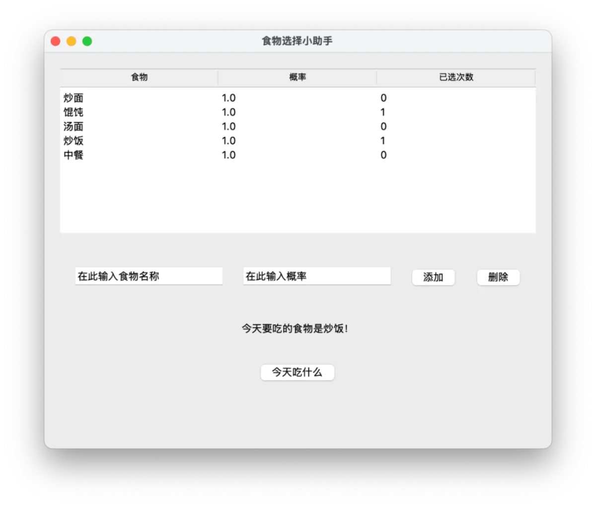
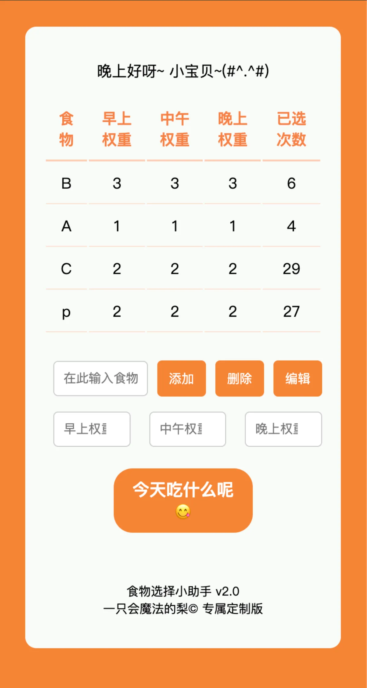
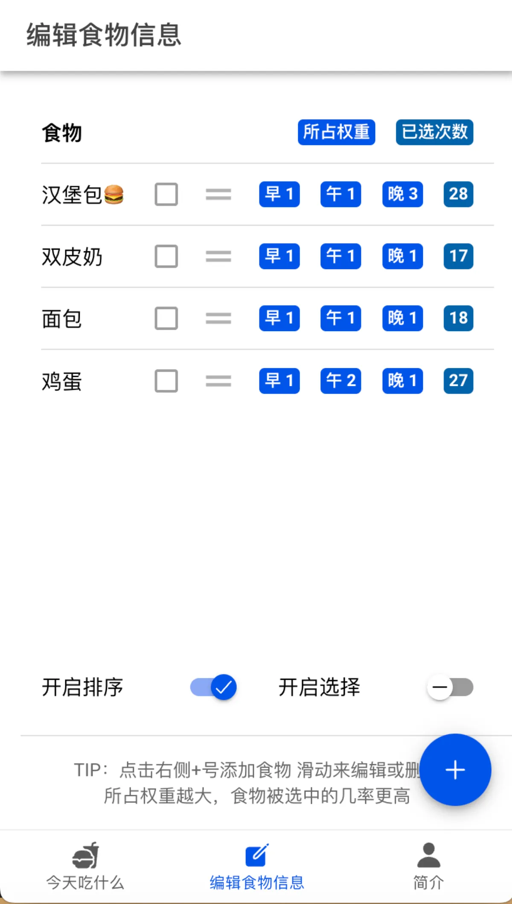
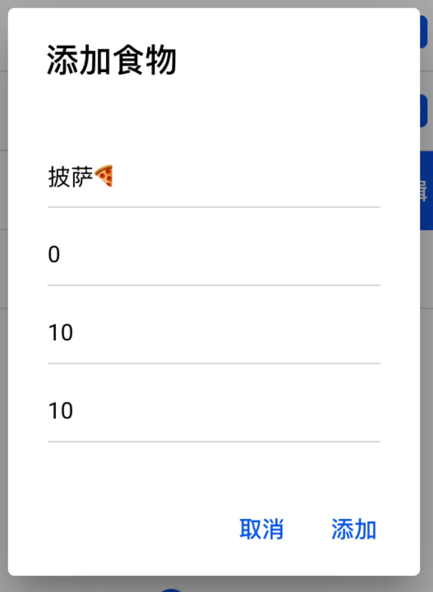
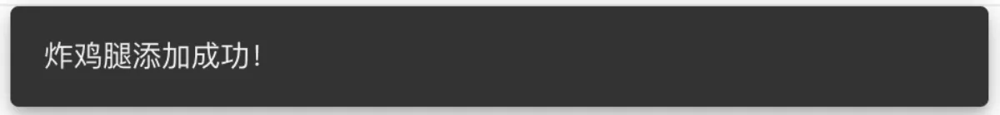
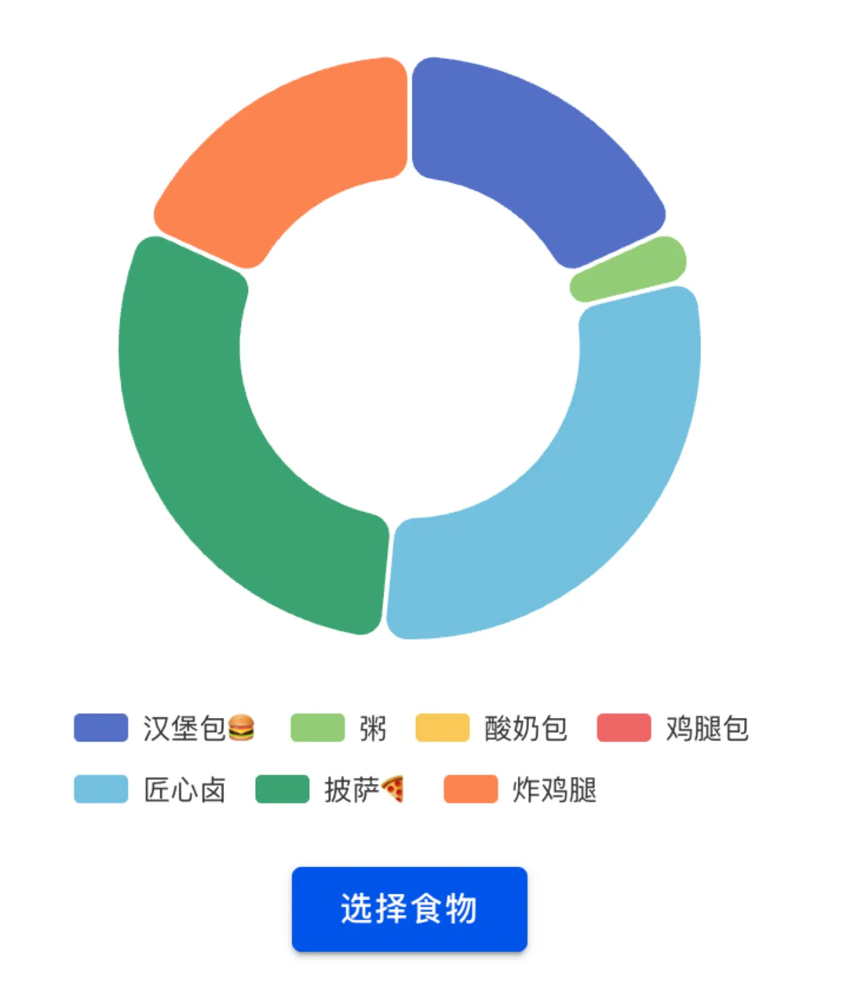

## 契机

我之所以做这个应用，最初是因为妹妹的一个请求。

> 哥哥帮我写个简单的小程序呗。  
> 问“今天吃什么”  
> 答“随机生成”  
> 随机生成的内容取自“炒面、馄饨、汤面、炒饭、中餐、口水鸡、猪肚鸡、水果捞、炸鸡、汉堡、烤盘饭……”

## 初始Python实现

算法很简单。一开始我想的是把每个食物存成一个键值对，像这样：

```
self.foods = {
    "炒面": 1,
    "馄饨": 2,
    "中餐": 3,
}
```

其中键为食物名称，值为其权重。  
一开始我用Python的Tkinter做了一个简单的版本。GUI界面如图：

<figure class="essay-figure">
  
  <figcaption>Tkinter构建的食物选择小助手</figcaption>
</figure>

上面的食物列表用了 `ttk.Treeview` 展示，下边就是几个 `tk.Entry` `tk.Button` `tk.Label`。这部分代码很简单就不做展示了。

## 使用简单HTML+JavaScript的重构

Tkinter虽简单吧，但我用它做的这个小应用毕竟太简陋了。  
还有个问题，Tkinter做的应用只能在电脑上用。平时纠结今天吃什么的时候总不可能总拿着个电脑出来吧。  
偶然间我在B站刷到一个视频，说怎么用AI十分钟帮你生成一个Todo List手机应用。我看了一下，就是写一个网页，然后用HBuilderX打包成安卓APK。  
我一想：  
安卓应用我不会写，网页我会啊！  
我就按着以前学JavaScript的时候的样子，写了一个简单的网页，长这样：

<figure class="essay-figure">
  
  <figcaption>2.0版本的今天吃什么</figcaption>
</figure>

上面的表格就是这样一个最普通的HTML表格：

```
<table id="foodTable">
  <thead>
    <tr class="tablet">
      <th>食物</th>
      <th>早上权重</th>
      <th>中午权重</th>
      <th>晚上权重</th>
      <th>已选次数</th>
    </tr>
  </thead>
  <tbody></tbody>
</table>
```

在JavaScript代码中，每个食物以食物名称为键，包含早中晚三个权重的对象为值。所有的食物使用一个字典 `foods` 来存储。

```
foods[foodName] = {
    morning: morningWeight, //早上的权重
    noon: noonWeight, //中午的权重
    evening: eveningWeight
};
```

在这个版本中，我还保存了每次选择的记录为另一个字典 `foodCounts`，下次点击选择时会检查之前的记录，并对实际供选择的食物列表作一些剔除：

1. 如果最近的两次连续选择了同一个食物，则不会继续选择该食物；
2. 为尽量保证30次内可以把食物选遍，在食物列表中存在近30次内从未选择过的食物，则优先选择这些食物。

接下来，在筛选后的可选食物中根据当前时间段再生成一个新的仅含可选食物和其对应时段权重的字典 `validFoods`。  
那么该如何选择我们想要的食物呢？直接随机选吗？那我们定的权重就用不上了。所以这里我采用了权重累加的方法：

- 对 `validFoods` 中所有的权重求和：
```
let totalWeight = Object.values(weightsForTimePeriod).reduce((sum, weight) => sum + weight, 0);
```
- 生成一个介于0到总权重之间的随机数：
```
let randNum = Math.random() * totalWeight;
```
- 从零开始对所有可选食物的权重依次作累加，直到累加得到的数超过上面生成的随机数，则选择当前食物。
```
for (let i = 0; i < validFoods.length; i++) {
    let food = validFoods[i];
    cumulativeWeight += weightsForTimePeriod[food];
    if (cumulativeWeight >= randNum) {
        // 选择食物的逻辑
        return;
    }
}
```

其余的编辑更新表格之类的是直接对DOM操作，实现得也不是很好，此处就不做展示了。  
实现完这个纯HTML+JavaScript+CSS的网页之后，我使用HBuilderX云打包成APK，然后就可以在安卓手机上用了。  
该版本的详细代码见 [AMagicPear/What-to-eat-today-web](https://github.com/AMagicPear/What-to-eat-today-web)，在 git 中切到标签 `v2.0` 处的 commit 即可。

## 使用Ionic+Vue3重构

<figure class="essay-figure">
  
</figure>

我感觉纯JS写这种网页好心累，于是心血来潮就去学了Vue3。  
学到一半，又是偶然刷到一个视频，展示了一个关于编程的排行榜，上面名列前茅的赫然写着一个Ionic。我就好奇Ionic是个啥，于是去它的官网一探究竟。  
不看不知道，一看吓一跳。我仿佛打开了新世界的大门——原来还有这种可以用Web构建移动应用的框架！竟然还能支持调用原生移动端的功能？那是不是就意味着……我的今天吃什么App也可以用这个技术来构建呢？  
Ionic官方文档里就有一步步构建一个photo-gallery的教程，也有Vue3的版本，正好也是当我练习Vue3的媒介。我就照着那个教程改。  
项目结构（简化后）如下：

```
src
├── App.vue
├── components
│   ├── DietManager.vue
│   └── WheelSpinner.vue
├── composables
│   ├── foodConstructor.ts
│   ├── foodSelector.ts
│   ├── log.ts
│   └── storage.ts
├── main.ts
├── router.ts
├── theme
│   └── variables.css
├── views
│   ├── EditFood.vue
│   ├── HomePage.vue
│   └── MyProfile.vue
└── vite-env.d.ts
public
├── LostInLight.png
└── favicon.png
index.html
```

那个路由（router）我在学Vue的时候也还没学到，就照着Ionic官方的例子来改。我现在也不是很明白到底是怎么个运作方式，所以就不讲了。  
`components` 文件夹内的 `DietManager.vue` 是导航栏， `WheelSpinner.vue` 是首页选择食物的转盘。 `views` 中的三个组件分别是选择食物、编辑食物信息、简介页面。 `composables` 文件夹内的则是处理食物存储和选择的具体逻辑。

## foodConstructor.ts

在讲食物编辑页面之前，我先来讲一讲 `foodConstructor.ts`。这个文件主要负责管理食物数据的构造、存储和操作。和之前纯JS的版本大不同，这里我重新组织了食物对象的数据结构，将同一个食物的各个信息放在一起，以便后期在各处使用。

### 定义数据结构

首先是每个食物的接口。我将单个食物内分为名称、权重、已选数量三种属性，而其权重又包括早中晚。

```
interface Weight {
    morning: number;
    noon: number;
    evening: number;
}

export interface IFood {
    name: string;
    weight: Weight;
    counts: number;
}
```

由于Vue是响应式的，这样设计的好处是存储和展示时均只需要引入 `foodList` 即可。

```
export const foodList = ref<IFood[]>([]);
```

### 食物列表的管理

食物的增删改统一封装在 `FoodConstructor()` 中。存储方式使用的是 `@ionic/storage`。用到时解包使用。

## EditFood.vue

这里边最重头的就是 `EditFood.vue` 了。此页面主要用于编辑食物信息，包括添加、删除、排序和选择食物。

<figure class="essay-figure">
  
  <figcaption>编辑食物信息页</figcaption>
</figure>

### 显示食物列表

- 使用 ion-list 和 ion-item 组件展示食物列表。
- 每个食物项显示食物名称、权重和被选次数。
- 使用 v-for 指令遍历 foodList 数组生成列表项。
```
<ion-list :inset="true">
  <ion-item style="font-weight: bold;">
    <ion-label>食物</ion-label>
    <ion-badge slot="end">所占权重</ion-badge>
    <ion-badge slot="end" color="secondary">已选次数</ion-badge>
  </ion-item>
  <ion-reorder-group :disabled="isOrderDisabled" @ionItemReorder="handleReorder($event)">
    <ion-item-sliding v-for="(food, index) in foodList" :key="food.name">
      <ion-item>
        <ion-label>{{ food.name }}</ion-label>
        <ion-checkbox slot="end" :disabled="isCheckBoxDisabled"
          @ion-change="toggleCheck(index, food.name)"></ion-checkbox>
        <ion-reorder slot="end"></ion-reorder>
        <ion-badge slot="end" v-for="(value, key) in food.weight" :key>{{mapTime(key)}} {{ value }}</ion-badge>
        <ion-badge slot="end" color="secondary">{{ food.counts }}</ion-badge>
      </ion-item>
      <ion-item-options side="end">
        <ion-item-option @click="editFood(food)"><ion-icon slot="end" :icon="create"></ion-icon>编辑</ion-item-option>
        <ion-item-option color="danger" expandable @click="deleteFood(food.name)"><ion-icon slot="end"
            :icon="trash"></ion-icon>删除</ion-item-option>
      </ion-item-options>
    </ion-item-sliding>
  </ion-reorder-group>
</ion-list>
```

这一块的代码看上去比较复杂，是因为我在里面杂糅了列表、排序、滑动选项、选择。简单来说就是外面是一个大的 `ion-list`，其中每一行是一个 `ion-item`。下面具体显示食物的部分的又由 `ion-reorder-group` 包裹，而其中每一行又由 `ion-item-sliding` 包裹，以实现同时可排序和滑动操作的功能。

<figure class="essay-figure">
  
  <figcaption>滑动操作演示</figcaption>
</figure>

在打开“开启选择”按钮后，在主页面选择食物时将仅从被选中的食物中选择。

### 编辑食物

#### 添加食物

- 使用 `ion-fab-button` 触发添加食物的弹窗。
- 弹窗使用 `ion-alert` 组件，包含输入框和按钮。
- 输入框用于输入食物名称和权重，按钮用于提交或取消添加操作。
- 提交后调用 `addFood` 方法，将新食物添加到 `foodList` 中，并保存到存储中。

<figure class="essay-figure">
  
  <figcaption>添加食物弹窗</figcaption>
</figure>

#### 调整食物

调整食物和添加食物的逻辑类似。也是使用 `ion-item-option` 触发编辑食物的弹窗，弹窗会预设展示当前想要编辑的食物的信息，修改后点击保存即可。  
我们在template中传入了 `food` （详细代码见上方）。

```
<ion-item-option @click="editFood(food)"><ion-icon slot="end" :icon="create"></ion-icon>编辑</ion-item-option>
```

这个food本就是响应式数据 `foodList` 中的一项，因此我们直接在负责保存的 `handler` 中对传入的食物信息作更改，然后保存即可。

#### 删除食物

传入要删除的食物的 `name` 属性，调用 `deleteFood` 即可。

### 通知

<figure class="essay-figure">
  
  <figcaption>页面底部通知</figcaption>
</figure>

在成功添加食物、成功删除食物等时刻，页面会弹出一个通知。这里使用 `ion-toast` 实现。为了避免每个通知都要新建一个toast，我把它的 `is-open` 关联到了 `message` 上。 `message` 是一个响应式的字符串。如果 `message` 非空，则会自动显示。

```
const message = ref<string | null>(null);
```

而 `didDismiss` 是一个在组件消失后会自动调用的函数。我又将 `didDismiss` 设置成 `message = null`，这样等这个通知条自动消失后 `message` 内的文本也会被清空。直到下次被设置成某个值后才会再次显现。

```
<ion-toast :is-open="message" :message="message" :duration="2000" @didDismiss="message = null"></ion-toast>
```

## foodSelector.ts和HomePage.vue

该版本的食物选择器沿袭了上代的特性。每种食物在被连续选择两次后的下一次不会再次被选择，且会优先选择近30次选择内从未被选中的食物。  
这里经过了三次筛选。第一次筛选：根据是否被选中来筛选；第二次筛选：根据最近两次选择的食物来筛选；第三次筛选：根据最近30次选择的食物来筛选。最后返回的是一个 `ValidFood` 类型的数组。

```
export interface ValidFood {
  name: string;
  weight: number;
}
```

后面根据权重随机选择的具体计算逻辑和2.0版本相同。  
由于我需要在首页中展示食物图，因此当前可选食物清单应该动态变化，于是我选择使用Vue中的 `computed` 类型的计算属性来定义当前可选食物清单 `validFoodsComputed`。  
在这个版本中，我把当前时间也设成了一个ref型变量。这是因为我要在转盘和选择食物函数中同时使用。另外，其实我在保存过去选择的食物的记录时也顺带保存了当时的时间。

```
export const timeNow = ref(new Date());
```

然而，这样 `timeNow` 是不会自动更新的。所以我还需要再让它每隔一分钟自动更新一次。

```
function updateTime() {
  timeNow.value = new Date();
}
onMounted(() => {
  setInterval(updateTime, 60000);
})
```

我还是比较小白的，就不知道这样的更新方式在性能上是不是合理。反正能用就是了。

## WheelSpinner.vue

<figure class="essay-figure">
  
</figure>

首页中的转盘我是单独写的一个组件，再嵌入进 `HomePage.vue` 的。  
一开始我从网上找了一个直接用canvas画圆盘的方案，但是转起来老出bug，而且我也不知道canvas里面的东西该怎么调。  
后来我选择使用 `Echarts` 的 `PieChart` 来画这个转盘。  
在点击选择食物按钮后，圆盘会随机旋转一个角度，旋转结束后高亮显示选中项。

## 结语

写了这么多我也写累了。剩下的细节都是比较无关紧要的，我就不再赘述了。想进去玩一玩的可以前往 [eat.amagicpear.top](https://eat.amagicpear.top/) 试用，本地安装版本在 GitHub 的 Release 里可以找到。
